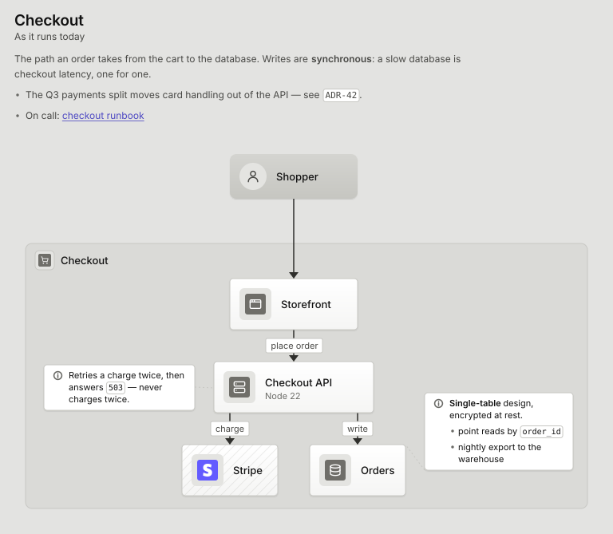
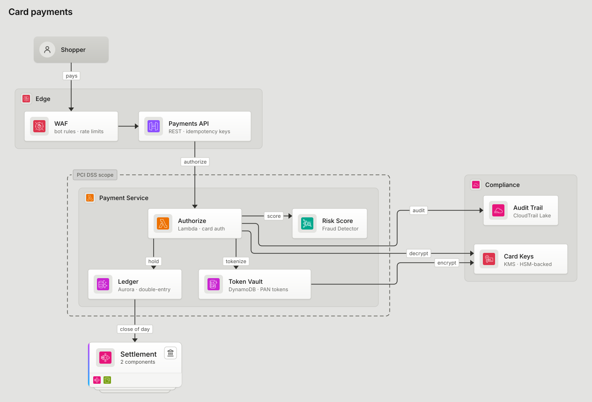
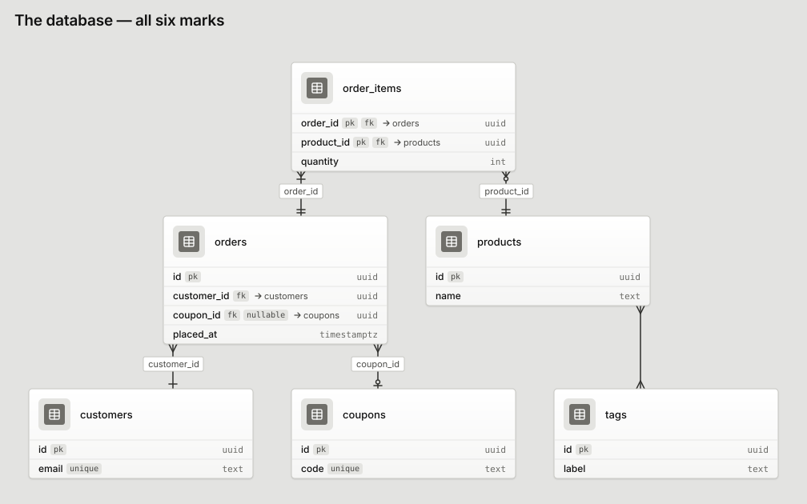

# Changelog

One log for the whole workspace — the engine, the CLI and the VS Code
extension share a single version (see `scripts/version.mjs`), so they share a
history too. Sections are drafted by `pnpm release` from the commits since the
previous tag, then edited by a human before anything is written; the release
workflow lifts the matching section verbatim into the GitHub Release notes.

## 0.22.0 — 2026-11-22

**Prose on the page.** A view can now carry a paragraph or two of context under its title: what the view shows, what is about to change, where the runbook is. Until now there was nowhere to put it. The header held a title and one subtitle line, a note stopped at three lines, and `**bold**` was drawn with its asterisks, so agents edited the rendered SVG instead and `render --check` failed on every run after.



No diagram in this repo redraws, and neither does a plain note. A view that asks for a `route` side may now draw it differently, because the side carries further (below). Run `render --check` if you use them. PNG exports redraw, with their titles in the right weight. Re-run `squinch skill` so your agents learn `about` and the new `route` rules.

### About and formatted notes

- **`about` on a view** sets prose in the header under the title, and the drawing moves down to make room. One per view.
- **`"""` block strings** span lines and are dedented, anywhere a string goes. Prose keeps the line breaks; one-line text reads them as spaces.
- **One small set of formatting**, the same for `about` and notes: paragraphs, `- ` bullets, `**bold**`, `` `code` `` and `[text](https://…)` links. Anything else is drawn as typed and `check` warns, and so does a link that is not http or https.
- **Notes are drawn whole.** A note grows to fit what it says rather than stopping at a third line with an ellipsis. Past six lines, `check` points at `about`.
- The lookbook has a new [About and notes case](https://github.com/jquatier/squinch/blob/main/lookbook/cases/45-about-and-notes.squinch), and the editor and the playground highlight the new strings.

### Route sides

- **A side carries through every wall around the node.** `route shop.api -> audit from east` now leaves API by its east side and leaves Shop by its east wall too, through zones as well. Before, it turned down inside Shop and came out of the bottom, with nothing said. A row-mate in the way no longer stops it: the edge goes over or under the row.
- **A side takes any number of edges.** The "that wall already carries a wire" refusal is gone. Edges asked out of one side are ordered so that none crosses another.
- **A wire asked out of the top or bottom goes round the nearer side.** It always turned east, so `from north` toward something to the west went round the far side of the box and back across its other wires.
- **A refused side says why**, naming the node, the side and the cause, with a fix line that writes the change. A `route` that names no edge in the view writes the spelling the view needs: the card while it is collapsed, the node inside once it is open.
- **`from` and `to` may be on separate lines** and in either order. Two lines asking one end for different sides are an error.
- The new [payments example](https://github.com/jquatier/squinch/blob/main/examples/payments/payments.squinch) uses route sides across three clouds. It draws with every icon pack and has no crossings.



### Fixed

- **PNG text is drawn in the weight it asks for.** Every PNG title and other medium or semibold text was drawn in the regular weight, because the bundled font files lost the family name resvg matches on. SVGs were never affected and do not change.
- **`route a -> b to east` turns the right end.** A lone `to` was applied to the edge's source.
- **A chain of hops gets one error.** `a -> b -> c -> d -> e` sent the parser into four unrelated errors with the real one sixth. It is now one error listing each hop to write.
- **`view db { title "Schema"  scope shop.db }`** got a bare syntax error. It now says `scope` starts a second statement and writes the line with a `;`.

### Agents

- The skill teaches `about`, the formatting, and to say things in the source, never in the rendered file.
- Gauntlet round 36, the first with `about`: 41 of 42 from the round, 31 of 42 clean on the first `check`, and the committed corpus scores 42 of 42. The new context prompt, which asks for a section above the diagram without naming the feature, was clean in one call.

### Also in this release

- Wide diagrams order about 10% faster, with byte-identical pictures.

## 0.21.0 — 2026-11-18

**Relationships between tables.** An edge between two tables can now say how many rows take part at each end, and it draws as crow's-foot marks in place of the arrowhead.

```squinch
orders      -> customers "customer_id" { from: many         to: one }
orders      -> coupons   "coupon_id"   { from: many         to: zero-or-one }  // the key is nullable
order_items -> orders    "order_id"    { from: one-or-many  to: exactly-one }
products    -- tags                    { from: many         to: many }
```



No existing diagram redraws. Re-run `squinch skill` so your agents learn the new attributes.

### Relationship marks

- **Two attributes, six words.** `from:` counts the rows of the table the edge starts at, `to:` those of the table it ends at. `one` and `many` say nothing about optionality; `exactly-one`, `zero-or-one`, `one-or-many` and `zero-or-many` state it. Write the plain words unless your schema says more.
- **Both ends or neither**, between two tables, on a plain `->` or `--` edge. Anything else is a check error that writes the line to use.
- **Drawn where both tables are.** In a view where the tables are inside a collapsed card, their edges and marks are inside it too. An edge with either end lifted draws as an ordinary arrow.
- **Nothing is inferred.** The marks are what you wrote. `check` warns when they contradict the column the label names: the ends look swapped, or a `nullable` key is marked as required.
- **Labels keep clear of the marks**, and a table with more relationships on one wall than it can hold apart gets a warning that names it. In a view that flows rightward that starts at five on one side.
- **A changed mark is structural** in `squinch diff`.
- The lookbook has a new [Relationships case](https://github.com/jquatier/squinch/blob/main/lookbook/cases/44-relationships.squinch) with all six marks.

### Fixed

- **A self-edge warns once, on its own line.** It used to warn once per view, at the view's line, including views that never showed the node. For a table, the warning now says to state the self-reference on the row: `manager_id uuid fk ref employees`.

### Agents

- The skill teaches the marks: plain `one` / `many` unless optionality is stated, a nullable key for `zero-or-one`, and marks only when the request or the schema gives the cardinality.
- Gauntlet round 35: 39 of 40 from the round, and the committed corpus scores 41 of 41. The new schema prompt put every mark on the right end, and a tables prompt with nothing said between its tables drew none.

## 0.20.0 — 2026-11-16

**Squinch has a layout engine of its own.** Until now every diagram was laid out by ELK, a general-purpose graph library, with three routers of ours bolted on for the things it could not draw. This release replaces all of it with one engine written for architecture diagrams, and nothing else. `elkjs` is gone and no dependency took its place.

**Every view redraws**, so run `--sync` after upgrading, and re-run `squinch skill` so your agents learn the simpler rules.

### Better pictures

- **A third of the crossings.** Across the 259 views this repo owned at the switch: crossings 73 → 22, bends 1,174 → 705.
- **Balanced by default.** A node whose edges fan out stands over the middle of them, and a stage that branches stands between its two successors. Symmetry wins over a straight wire, every time.
- **Nothing almost-aligned.** Every node's centre sits on one 8px grid, so two nodes are on a line or a clear step apart. No jog is too short to draw as a corner.
- **Every edge ends on the node it names**, inside expanded containers and zones too. A wire no longer stops at a container's wall and leaves you to guess which box it meant.
- **Labels stay readable.** An edge label is crossed by no wire but its own: it moves along its wire to a clear place, and where there is none its neighbours make room.
- **Notes keep their place.** A note beside a node stays inside that node's container or zone; a note on an edge stands beside its wire. The engine reserves the room, so nothing has to dodge.

### Much faster

- **Layout is about ten times faster.** The same corpus: 2.5 s → 0.25 s; the median view went from 8 ms to under 1 ms, and no view got slower.
- The 200-node benchmark (layout and render) went from 65.8 ms to 13.6 ms on the reference machine.
- `@squinch/core` installs smaller by the whole of ELK, and the playground loads less.

### Fewer things to get wrong

Several errors and warnings existed only because the old engine could not draw what you asked for. They are gone, and the diagram is simply drawn:

- **An edge running back up your `rows`** — a retry, a feedback loop, a monitor. The "hint conflict … runs upward" error is gone, in a view and in a container's own `layout { }`.
- **A `rows` band is kept whole**, whatever unlisted node lies between its members.
- **Two members of an expanded container may share a row** with an edge between them.
- **Hints reach inside zones.** `rows`, `cols` and `place` arrange a zone's members, and may name a zone by its id to arrange the zones themselves.
- **`wrap N` folds any row wider than N**, in the view and in every container it opens, and a container's own `layout { wrap N }` follows it wherever it is opened. It used to fold one chain or one fan-out and warn on everything else.
- **`align` and `cols` hold exactly**, inside containers too.
- **`route … from/to` is honoured** on edges that span rows, and `check` says so where a side cannot be used.

What `check` still tells you, because it is still true: two nodes on the same row "cannot share an axis" (side by side is `rows`), a `wrap` that folds nothing, a `channel` that is not fully visible. No combination of hints can draw two nodes on top of each other.

### Also in this release

- **Attributes on one line need nothing between them.** `{ tags: #poll  animate: pulse }` parses; comma, semicolon and newline still work.
- **An unknown icon id that is a word, not a typo, gets real answers.** `sys/download` now says ``closest: `sys/hard-drive-download` `` where it used to say only "run a search".
- The lookbook's `align`, `rows`/`cols`, `route` and `wrap` cases are reworked so each shows its feature on the new engine, and `rows` gains a view with a retry running back up the pinned rows.
- Gauntlet round 34, the first on the new engine: 39/39, 28 of 39 clean on the first `check`, and no agent hit a layout error.

### Known rough edges

- A few very dense diagrams draw more crossings than before.
- `route … from/to` takes the side you ask for, not the side nearer the edge's destination.
- Canvases are a little tighter, so a note pinned to a corner sits closer to the content.

`docs/notes/layout-engine.md` records why the engine was replaced, how the new one works, and every decision behind it.

## 0.19.0 — 2026-11-11

- Tables show their fields wherever their container is open. Inside an expanded container (`expand db`, `expand *`) each table draws a compact list with no `preview` needed; a view scoped to the container still shows every field. `preview <table>` is now only for a table at the top level.
- `preview <table>` beside `expand *` no longer errors. A seven-field table shows all seven instead of six and "+1 more field", a `preview: [...]` list holds up to twelve, and `preview: none` keeps a table plain outside its own view.
- Wires land on a table's head, never on a field row.
- Nothing on a row leaves the card: long names and marker runs are cut, with the full text in the tooltip. A caption draws on its row when it fits.
- `check` warns when fields are written that no view can draw, and names the line to add.
- **Views that draw fields redraw**, so run `--sync` after upgrading. The README has a new "Tables and fields" section; re-run `squinch skill` to teach agents.
- Gauntlet round 33: 38/39, 29 of 39 clean on the first `check`.

## 0.18.0 — 2026-11-10

- Tables can show their schema. Give any leaf a `fields { }` block, one field per line — `id uuid pk`, `status enum(pending, paid)`, `customer_id uuid fk ref customers`. Fields draw in a view scoped to the table's container, or under `preview <table>`; every other view is unchanged. See lookbook case 43.
- `check` fixes what agents write by habit — `schema {`, nested blocks, SQL `--` comments, pasted Prisma syntax — and `scope` on a table now points at its container. `squinch diff` reports schema changes; the editor completes field names. Re-run `squinch skill` to teach agents.
- PNG exports draw mono text in the mono face; it was falling back to Inter. **Views with a zone `detail:` or a titleblock `commit:` redraw**, so run `--sync` after upgrading. Browsers are unaffected.
- Gauntlet round 32: 39/39, 28 of 39 clean on the first `check`, with a new schema prompt.
- The site's icon card shows a row per pack instead of a count.

## 0.17.1 — 2026-11-03

- Update notices appear again. The CLI never waited for its once-a-day registry lookup, and since every command's work is synchronous the lookup could not run before the process exited, so `check`, `--version`, `icons` and single-view renders never recorded a latest version and never said one was out. A started lookup now gets up to half a second after the command finishes; a fresh cache starts none and costs nothing, and a failing command keeps its exit code.
- `render -o x.html --theme <name>` says that it shipped that palette alone, with no light/dark switch, and how to get both. `--help` now says what `--themes` defaults to: both palettes with a switch, unless one is named.
- The site: the palettes band on the landing shows the Kubernetes cluster rather than the products API.

## 0.17.0 — 2026-10-31

- A leaf's title can be a hyperlink. `link: "https://…"` on a leaf or person makes the title open in a new tab; hovering it shows a pointer and underlines it, and the rest of the leaf stays draggable. Only `http` and `https` are accepted, anything else is a check error, and a container warns because clicking a card zooms into it. A browser only follows a link in an SVG it opens or inlines, so one shown through `` does not react, and a PNG carries no link. The skill teaches the attribute and tells agents never to compose a URL they were not given.
- Long leaf names show in full. A long label widens its leaf to 280 or 320, then takes a second line, and only then is cut. A subtitle alone still stops at 240. In a left-to-right flow, a column of mixed widths keeps one left edge.
- **Diagrams with long labels redraw**, so `render --check` reports them stale until you run `--sync`. Diagrams with no cut labels and no mixed-width columns in a left-to-right flow are unaffected, apart from a card name within 4px of its width limit, which used to be cut with a wider size free.
- Cut text can still be read. A leaf, person or card that had to cut its text keeps the full text in a `<title>`.
- The label warning now tells the truth. It fires when a label will really be cut, measured rather than counted, so it catches a card name cut at 27 characters and no longer flags a long name that fits two lines.
- The interactive export's first breadcrumb no longer vanishes when clicked. With two unscoped views and a short path, opening its menu folded the hop away. The playground's same menu now closes on Escape and on a click outside it.
- The export's home button draws the playground's icon rather than a character from whatever font the reader has.
- Pan and zoom: tabbing to an off-screen link now pans the camera. It used to scroll the stage behind the camera's back, which threw off every later gesture.
- The `squinch` npm package ships the root README, with its relative links pinned to the release tag.

## 0.16.0 — 2026-10-11

- The language takes two shapes cold agents kept writing. `person id "Label" { description: "…" }` accepts the attr block the inline `id = person "…" { … }` form always did — one declaration, two word orders, the same checks on the block, and a duplicated top-level person is now a duplicate-id error instead of a silent overwrite. `expand`, `preview` and `detail` take a comma list, one entry per path, as `exclude` does; an unknown id in the list is reported at the id.
- Edge labels no longer land on a crossing. ELK reserves a cross-rank edge's inline label at its median layer, and when that edge threads the gutter a same-rank wire runs through, the median layer is the wire's — so the pill sat on the wire, or on the wire's own label. Neither router saw the other's reservation. A pass after they merge slides the ELK pill along its own run to the nearest clear spot; no committed render had the shape, so nothing else moved. `docs/notes/edge-labels.md` has the measurements and the rejected ways.
- The skill is a directory. The layout cookbook moves whole into `references/cookbook.md`, grouped by theme with a contents list; the quality bar moves above the language, since Claude Code keeps only a skill's first 5,000 tokens after context compaction and the checklist sat last; and the frontmatter says what it needs (Node 22 and the `squinch` CLI, or `npx squinch`). `squinch skill` installs the set and `--print` streams it. The per-pack icon lists stay in the body on purpose: round 31 measured that no cold agent opened a reference file, six guessed an icon id with the lists moved out, and none did with them back. The hand-over also ends with an offer to cut the diagram down, naming what it would cut, and `squinch skill` no longer warns about the copies it has just replaced. The `sys/*` pack gains a commerce row — cart, checkout, payment, order, shipping, and friends — the icons agents reached for and missed.
- Gauntlet rounds 30 and 31: 38/38 on the deep scorer both times, 18 then 20 of 38 clean on the first `check`. Prompt 34, which had varied since round 26, now says what the diagram is for — an overview that fits on one screen, then a page per part — after six cold runs on the old wording passed none and six on the new passed all six; rewording the skill's big-system section was measured first and moved nobody. Both rounds are written up in `gauntlet/README.md`.
- The repository: author-controlled values reach the CI actions through the environment rather than string interpolation, every action is pinned to a commit and the Pages upload no longer goes through a composite that pins nothing, dependabot is on with grouped updates, issue forms and a code of conduct are in, Node is pinned once in `.node-version`, and the five transitive advisories dependabot could not resolve are resolved by refreshing the lockfile.
- Releases publish to npm directly. The release run authenticates by trusted publishing and publishes every package itself; a green run is an installable release, and the tag push that starts it is the only human step.

## 0.15.0 — 2026-10-07

- The skill's hand-over changed. An agent now rasterises each view beside the source and looks at it, leaves out anything the request does not support — including glue it would put between two things the request names — and ends with three or four plain bullets: where to open it, what it guessed, what it saw. It also learned to pick `wrap N` for a slide: N ≈ √(nodes folded), rounded up, and no `direction right` on a wide fold.
- `check` and the editor lay out every view the interactive export draws, auto views included. A system's own `layout { }` block could check clean and then fail `render -o x.html`; that is now a check error, pointing at the block. Layout errors also name their file — `catalog.squinch:7:3`, not `input:7:3` — in the human and JSON formats alike.
- `check` warns when a previewed card has one child: its one row repeats the card.
- Gauntlet round 29: 35/37 on the deep scorer, 25 of 37 clean on the first `check`. A prompt can now check out a real repository at a pinned commit, and prompt 38 diagrams Google's Online Boutique from its code, scored against the call graph the code has. The corpus is certified 38/38; both are written up in `gauntlet/README.md`.
- The site: the pages' shared chrome is written once, the title and copy say "for AI coding agents", the landing's demo clips are video at a third of the GIFs' bytes, the header nav holds one row on phones, and the footer says what the name means.
- Releases stage the eight npm packages through OIDC with no token; nothing is installable until a human approves them with 2FA.

## 0.14.0 — 2026-09-29

- The skill teaches tables. When the reader asks what is in a database, an agent now writes it as a `container` holding one `sys/table` per table: one card where it sits, a dive that opens onto the tables, and each foreign key a labelled edge. Where the table is itself the deployed resource, as on a serverless store, it stays a node in the service that owns it, with no container invented to hold it. Nothing in the engine changed — the idiom already worked and nothing told an agent it existed. Columns are out of scope: squinch draws tables, not schemas. Re-run `squinch skill` to install it.
- Gauntlet round 28: two prompts for the tables idiom bring the corpus to thirty-seven, certified 37/37 on the deep scorer. Both passed, and none of the standing thirty-five opened a database unasked. The scorer gains two expectations, `inside` and `siblings`, matched by label. The round is written up in `gauntlet/README.md`.
- The site: the zoom GIF wears the view bar — the home button climbs and the top menu opens full detail — the landing's mascot stands beside the quotes, and the social card and JSON-LD spell squinch in lowercase.

## 0.13.0 — 2026-09-27

- The stacked sheets behind a container card peek out below it instead of echoing it. Two outline rects offset back and down read as a doubled border at diagram scale; the stack is now two solid sheets straight under the card, 6 and 12px down and 12 and 24px in from each side, a shade darker as they recede. Only the strip that shows is drawn, so a card dimmed by `highlight` or a flow step no longer has a ghost rectangle behind it, and nothing bleeds right, where `direction right` wires leave. Themes gain a `sheetFillNear` token for the near sheet.
- Edge labels clear the sheets. ELK spaced the label on a wire leaving a card from the card's own edge, so at the new depth all 32 such labels in the corpus landed in the stack. A card now reserves the sheets' room at layout — an invisible node label under it, which ELK counts when it spaces the next layer — so the label, or the next node, lands below the stack while every port stays on the card. Anything under a card sits 12px lower, and views whose context cards reserved room for sheets they never draw are up to 8px smaller. The invariant sweep now fails a label that overlaps a card's sheets; `docs/notes/edge-labels.md` records the ELK options that do not work (`elk.margins` among them).
- The view bar fits a phone. It loaded at full width and ran off the left edge: two layout effects collapsed into one no-op render, so nothing was measured. It now folds on first load and on resize, two more fold steps cover a 320px screen, and it centres beside the editor toggle. An e2e test holds it on screen at 390 and 320px.

## 0.12.0 — 2026-09-26

- A view bar replaces the view tabs, in the playground, its presenter and the interactive HTML export. The tabs were one flat row of view names that ran off the edge past eight views, and a nested model has a dozen before anyone writes a `view` block, since every container earns an auto view. The bar is a home button, then the path down to the view you are on, with each step a menu of the views beside it at that altitude. A container with more than one view gets a lens step ("1 lens"), and one with views inside it an inside step ("4 inside"). Flows sit apart in their own pill, which is a named link when there is only one. A lens titled after its container drops what the path already says ("PCI surface", not "Order Service — PCI surface"). One core function, `viewBar`, describes the bar, and each surface only draws it, so the playground and the export cannot disagree. `docs/notes/view-bar.md` records the options it beat: bounded tabs, a single picker pill, an outline rail and a filmstrip.
- Short of room, the bar folds in steps instead of overlapping. Labels truncate first, then the outer ancestors fold away, then the flows pill drops to its icon, then the nearest ancestor goes. The bar measures whether it fits rather than trusting breakpoints, because the editor pane decides how much room there is. It works down to a phone, where menus stay on screen and the export hides its zoom buttons in favour of pinch. To give the bar the playground's top edge, the editor toggle becomes an icon and the render-time readout moves beside the zoom pill.
- Presenting, `B` or the bar's own button puts it away for the rest of the talk, leaving a sliver at the top edge that brings it back on hover or click. The presenter's dots are gone; the `n / N` counter stays. `Home` goes to the landscape in both presenters.
- ⌘/Ctrl `+` `−` `0` zoom the diagram in the playground, in presentation and in the export, from one key table. They used to fall through to the browser's page zoom while ⌘/Ctrl+scroll zoomed the canvas. They now work from the editor too, a focused button no longer swallows the bare keys, and a press mid-zoom steps from where the zoom is heading, so a held key gets every step.

## 0.11.0 — 2026-09-25

- The light theme moves to a graphite ground. The first light palette was near-white on near-white — a `#F7F7F5` canvas under white cards behind `#EAE9E5` hairlines — and diagrams read washed out. Cards stay white, but the canvas drops to a neutral `#E3E3E1` a clear step under them, and borders, secondary text and edges each move a step darker (ink `#111111`, muted `#474744`, edge `#2F2F2C`, accent and async `#4C47C2`). It is still neutral, so it still pairs with `dark` for `--adaptive`. The `gray` hue deepens to `#62625C` so a gray zone reads on the darker ground; the other seven are unchanged. Every light render moves; every dark render is byte-identical.
- People stand out again. The actor tile is filled and borderless, and its gradient began at the icon-plate tone, which the new canvas sat within 1.01:1 of — a person's top half dissolved into the ground. Themes gain an `actorHi` token for the tile's own top stop (1.16:1 against the light canvas, twice what the original design had), and a theme test holds every theme's actor tile clear of its canvas.
- The playground's stage floods with the diagram's own ground: its background is the theme's canvas colour exactly, in light and dark, and the dot grid is gone, so a render no longer sits on the stage as a visible rectangle. A test holds the stage colours to core's theme table.
- The site: the social card carries the landing's tagline, every install command gets a copy button (the command goes to the clipboard, its `#` asides stay on the page), and the landing's category lines rise in one at a time. The light demo GIFs are regenerated on the new ground.

## 0.10.1 — 2026-09-23

- A pinned mutual pair takes two lanes, not one line. `rows [a b]` with `a -> b` and `b ~> a` drew both same-row wires at the pair's mid-height: one collinear line, ports stacked at a point on each face, arrowheads over each other, and one label pill under the other. The router's straight branch held that two straight same-row wires cannot collide, because a second target on a face is blocked by the first — true, and silent on a second wire to the same target. Wires between one pair now take lanes on the faces they share, the face divided into even slots the way ELK spreads the parallel ports it owns, measured off the first-declared wire so each stays straight and the group sits centred. A lone wire keeps the centre it always had, so 224 of 225 corpus views are byte-identical; the mover is lookbook `09-coplanar-row`, which gains a return edge between two neighbours to keep the shape in the invariant sweep.
- The playground draws a container's own `icon:`. The browser host preloads exactly the icons `iconsUsedBy` returns, and a container's icon was missed from the day the attribute was added — every `icon: sys/store` card was a bare plate there while the CLI drew it, and the detailed card made it visible as nine empty tiles in the preview-card lookbook case. Glyph and icon now go through one loop, and a test pins the full list: leaf icon and badge, zone icon, container glyph and icon.

## 0.10.0 — 2026-09-22

- The detailed card. A view's `preview orders` — or `preview *` for every card it shows — draws a collapsed system's card taller, with the children its `preview:` names as readable rows under the same head: icon, name, and the child's `subtitle:` or `description:`, with `+N more` on the shelf for the rest. It is the altitude between a card and an opened frame, and it is still a card: every wire lands on it exactly as before, a dive still opens the whole system, and `only` and context never see the rows. The head keeps its height so a detailed card lines up with its plain neighbours in a rank; three rows make it exactly twice as tall, never wider. Which children are named is a fact about the system, so the list lives on the container; whether to show them large is a fact about the picture, so the verb lives in the view — a landscape has room for it, a dense view does not, and one model serves both. `docs/notes/preview-card.md` records the shapes that were rejected: a filtered frame (wires to the shown parts and vague stubs to the hidden ones, side by side), a strip of mini tiles (truncates at card width), an automatic top three (cannot name "the parts people know"), and a container attribute for the altitude.
- `preview: [api queue worker]` on a container now parses and does what the spec has promised since v0: the shelf's icon chips show the children the author named, and `+N` counts the direct children left out. The list is checked with a did-you-mean; more than three warns and names what folds into `+N`. `auto` means the first three children *declared*, direct children — a nested container is one chip wearing its own card face, not its leaves spilled out. Six corpus renders moved, all cards over a nested container: the landscape example's Order Service shows `api`, `handlers`, `db` where it showed `api`, `create`, `get`, `+1`.
- A badge mark that would vanish into its plate draws in the theme's ink. Near-black brands — Kafka, GitHub, Vercel — were invisible on a dark-theme badge; the mark now yields to ink when its brand colour sits too close to the plate's, by the same deterministic lightness measure the knockout chip uses. The plate never changes, and no existing render moved.
- Gauntlet round 27, run to see how often cold agents reach for the new verb: with the guidance in the Views section, none of thirty-five did. One bullet in "When the system is big" — describe each area, name its three recognisable parts, `preview *` on the landscape and only there — and two of the six large-system agents used it, on the landscape only, with descriptions on the children. The round also surfaced two defects: a coplanar co-ranking failure on a mutual pair, fixed below, and a lifted edge label drawn over a leaf, filed for its own change. A lookbook case, `41-preview-card`, shows three domains of nested systems under `preview *` beside the same model as chips.
- An unhinted mutual pair is two ranks, not one. A bus that every area publishes to and consumes from lifts to a two-node cycle at landscape altitude (`catalog -> kafka`, `kafka ~> catalog`), and the longest-path rank relaxation has no fixpoint on a cycle: it ran out its pass budget with both ends on one rank, the router took both edges for coplanar and hid them from ELK, ELK layered the two apart, and each wire ran straight at its own height into empty canvas. Ranks now break cycles before relaxing, the way ELK does before layering — edges in declaration order, one that would close a cycle left out, so the first declared wins and the closing edge reaches ELK as the ordinary cross-rank edge it is. A pair the author pins to one row is a declared rank and is untouched. 223 of 225 corpus views are byte-identical; the mover is the gauntlet answer that carried the cycle. Lookbook case `42-mutual-pair` keeps the shape in the sweep.

## 0.9.0 — 2026-09-22

- A Google Cloud icon pack. `@squinch/pack-gcp` ships the 45 icons of Google's 2025 product icon system: 19 core products with their own four-colour mark (Cloud Run, GKE, Compute Engine, BigQuery, Spanner, Cloud SQL, AlloyDB, Cloud Storage, Vertex AI, Looker, Apigee, …) and 26 two-colour category glyphs. Every other product draws as its category's glyph, which is how Google draws them now, and 276 aliases make that resolve by the name you know: `gcp/pubsub` and `gcp/dataflow` draw the Data Analytics mark, `gcp/cloud-functions` the Serverless one, `gcp/firestore` and `gcp/memorystore` the Databases one, `gcp/iam` and `gcp/secret-manager` the Security one. Put the product name in the label; the icon says the category. The 216 legacy per-service icons are deliberately absent — Google's own guidance says they should not be used as of 2026. Google publishes the library for diagrams and documentation and grants nothing further, which the pack's NOTICE states in full: use it for Google Cloud architecture diagrams and documentation and nothing else. `squinch icons search --pack gcp <term>` scopes a search, the skill gains a Google Cloud section, the playground's icon credits list the pack, and a lookbook case shows both tiers in both themes.
- The pack sanitizer promotes `<style>` class rules onto the shapes as presentation attributes before it drops the stylesheet. Sixteen of Google's files carry all their paint that way and rendered as black shapes without it; so did one Azure icon, `azure/intune-trends`, which is painted for the first time. Bare class selectors and paint properties only, a CSS value beating a same-name attribute, `url(#…)` values namespaced exactly as an attribute's are. A file with no `<style>` sanitizes byte-identically to before, and every committed render is unchanged.
- The site: `/compare/` sets the microservices example beside Mermaid, D2, Structurizr, Python `diagrams` and Archify, each drawn by its own agent under the same rules — every render as the tool produced it, every source committed beside it with the command that drew it, and one switch flipping every panel between the landscape and full detail. The landing gains a light/dark comparison slider for `--adaptive`, a native range input so pointer, touch, keyboard and screen readers all get it, and its title and heading now say "architecture diagrams as code".

## 0.8.0 — 2026-09-20

- Pan and zoom, in the playground and in the interactive HTML export. Drag or scroll to pan; pinch, or Ctrl/⌘+scroll, zooms about the cursor; `+` `−` `0` `1` and Shift+arrows do it from the keyboard; on a phone one finger pans and two pinch. The playground used to zoom only from a button pill — 25% a step, about the centre, with the left and top overflow unreachable at high zoom — and the export could neither zoom nor pan. Both now run one camera, the same controller bundled into the export and called from the playground, so they cannot drift into two feels. A view opens as it always did, width-fitted and from the top when it is tall; every view arrives fitted after a dive, whatever was done to the one before; and the dive starts from exactly what was on screen. `docs/notes/pan-zoom.md` records the decisions and what was rejected.
- What that changes for a reader: a tall diagram no longer shows scrollbars (the wheel pans the same way); diagram text is no longer selectable, because a drag must pan; Ctrl/⌘+scroll and a trackpad pinch zoom the diagram instead of the browser page; and in the playground the zoom no longer carries from one view to the next. The zoom pill steps ×1.25 up to 400%, its readout is the live percentage (click it for 100%), and zooming out always reaches the whole diagram.
- The interactive export gains `−`, `%` and `+` in its bar, and three fixes found on the way. Clicking the margin *around* the artwork now climbs a view — only the artwork's own background did, and the test that claimed otherwise passed without climbing. Space and Enter on a focused button activate it: the key handler used to swallow them and step the deck, so every button in the file was dead to the keyboard. Shift+arrow pans where it used to step, and Present scales a small diagram up to fill the screen as the playground's does. A reader without script sees the same static, width-fitted diagram as before, and no dead controls. The bundled viewer goes from 7.3 KB to 13.6 KB, in every export.
- On iOS the playground and the export size to the dynamic viewport. `100vh` there is the height with the browser's toolbars hidden, so the zoom pill and the export's view tabs sat underneath the bottom bar.
- In Present, a held ⌘, Ctrl or Alt belongs to the browser again: ⌘− zooms the page and ⌘← goes back, where the deck used to step and swallow them.
- For hosts: the camera's arithmetic (`fitCamera`, `zoomAt`, `wheelPan`, `toLocal`, …) is exported from `@squinch/core`, and `attachCamera` from `@squinch/core/browser` — the latter unstable, and not part of the engine's API. The pre-commit hook regenerates the export's runtime for edits under `src/view/`, which it has always bundled from.

## 0.7.0 — 2026-09-19

- The skill knows what to do with a large system. Pointed at a whole repo, an agent used to draw one enormous page, or a landscape with every backend in a single row. A new section, "When the system is big", and a step at the top of the loop tell it to decide the *areas* before writing a node: group by the folders, teams or domains the code already has, keep what a service owns inside it and what everyone shares top-level, hold that at every altitude, and hand over a landscape plus a view per area rather than one page. It carries no numbers — no box limits, no aspect ratios. Measured with cold agents it helps most where the repo already has structure, and only partly where it does not.
- A band the layouter could not keep is a check error. `rows [identity catalog commerce …]` with an unlisted bus on the path between them (`identity ~> kafka ~> catalog`) used to come back as two tiers with nothing said, and the router drew a stub wire into empty canvas. `check` now names what sits between them and writes the `rows` line to paste, trying the wedge in a band of its own, then beside the lower tier, then the upper, and offering the first with no upward edge. Files that relied on the silent split will now fail `check`; none of the 67 views in the corpus that use `rows` did.
- An edge written from a container itself (`checkout ~> fulfilment`, with `checkout` expanded) no longer stops in mid-air beside a shorter neighbour: a container endpoint jogs through the gutter like any other unit. No existing render changed.
- A container's `icon:` is validated like its `glyph:` and a zone's `icon:`. A made-up id used to pass `check` and draw a `?` tile; it is now an error with a did-you-mean or the search command.
- Gauntlet: two large-system prompts bring the corpus to thirty-five, certified 35/35 on the deep scorer. Round 26 is written up in `gauntlet/README.md`, including what the runs before it showed about where guidance does and does not move an agent.
- Site: the landing's trust band claims only what the render path guarantees. Release: npm publishing runs as a deployment to the `npm` environment.

## 0.6.0 — 2026-09-15

- `squinch` says when a newer version is on npm: after a successful command, one `update:` line on stderr names the version and the upgrade command (`npx squinch@latest skill` when run through npx). The lookup is one registry request a day, cached under `~/.cache/squinch` and never awaited — a slow or offline registry costs nothing and the notice arrives on the next run — and it is off under `CI`, `GITHUB_ACTIONS` or `SQUINCH_NO_UPDATE_CHECK`. It is never gated on a terminal, because the reader is usually an agent; `check --format json` carries it as an `update` field instead of a line. `docs/notes/update-check.md` records the rejected shapes.
- A skill installed by a different squinch is named: `skill: <file> was installed by squinch 0.5.0, this is 0.6.0 — re-run squinch skill`, one line per `.agents/skills` or `.claude/skills` copy in the project or under `$HOME` whose install stamp differs ("upgrade squinch" when the stamp is the newer one). Offline and deterministic; a copy with no stamp stays silent. The skill's own rule 4 tells the agent both lines are information, not diagnostics, and never to upgrade or reinstall unasked — an upgrade can change render bytes.
- Core's guardrails now ban `fetch`, `AbortController` and `process.env` beside the clock and the RNG: the CLI's update module is the one place in the product that reads the environment or the network.
- Lookbook: every case describes the feature it shows rather than the history behind it, and the landing carries a fourth quote.

## 0.5.0 — 2026-09-14

- `subtitle:` on a leaf — a short second line under the label, always drawn, for what a few words can say: runtime, owner, region. The card's tier widens for it as it does for a container's description; past 24 characters it warns and points at `description:`; `tech:`, `stack:` or `caption:` on a leaf name it as the fix, and on a person or a container the check says where that line comes from instead.
- Async wires are beaded: `~>` edges and their legend sample draw `4 7` round-capped dashes in place of the `6 5` butt dashes. The drift period is unchanged, so every animation timing stands.
- An expanded frame's header echoes its collapsed card — the 24px icon chip (the authored `icon:`, else the first leaf's) and the label in ink rather than muted text — so a reader diving into a container lands on the thing they clicked.
- `show descriptions` is retired: a description is prose, and the line under a leaf belongs to `subtitle:`. The flag now warns and draws nothing; collapsed cards keep their description as the tagline, and people carry their label alone.
- Unknown attribute keys warn on leaves, containers, zones and notes with a did-you-mean (`owner` → `domain`, `tech` → `subtitle`, a zone `description:` names `detail:`), as do unknown note styles. A chained edge — `a -> b -> c` — is an error naming the two lines to write and the `flow` where hops do chain.
- Examples: the microservices, storefront and products API projects carry subtitles, and the hero and prompt GIFs are re-recorded with the new anatomy, looping the dash drift over one whole period so the wire no longer jumps at the seam.
- `pnpm release <version>` reads the version from the command line again; without `--notes` it had fallen through to the prompt.
- Gauntlet rounds 24 and 25: 33/33 on the deep scorer, 25 of 33 clean on the first `check`; fourteen cold agents wrote `subtitle:` unprompted. The scorer counts containers among the nodes drawn and reads a container's own `icon:`, and the runner resolves resvg's Linux build and scans only tool inputs for sandbox escapes.

## 0.4.0 — 2026-09-13

- A container carries its own layout: a `layout { }` block inside a `system` or `container` body arranges its direct interior — `rows`, `cols`, `place`, written by short name — wherever that interior is opened, as an expanded frame in any view or as the root of a view scoped to it, its auto view included. A view's own hints replace the block per container, all or nothing; a second `rows`, `cols`, `direction` or `wrap` line in one block is now an error instead of a silent drop; and a block whose bands run against the interior's own edges is a check error whether or not a view opens the container. View-level `rows`/`cols`/`place` naming leaves inside an expanded container take effect too — they used to render byte-identical to no hint at all.
- A container's own direction: `direction right` in that block lays its interior out as a row wherever it is opened, inside a view that still flows down. The frame is laid out by an ELK call of its own with its wall ports as hierarchical ports, edges crossing the wall are cut and stitched back into one polyline, a stage that goes on somewhere keeps its row while a dead-end branch hangs beside it, and a frame title a wire runs through is drawn last on a halo — which also fixed three shipped views that already had a wire through a title.
- `wrap N` is the one aspect-ratio knob: it folds a single chain into a serpentine, or a single source's fan-out into bands under it with the band-skipping edges drawn as one bus. Any other shape warns and names the `rows` line to write by hand; `wrap` beside `rows` or `cols` is an error.
- The interactive HTML export bundles a flat project — no `view`, no container — through the implicit view the SVG path always used, instead of refusing it; `rows` bands continued on a second line get one error naming the fix; `expand` inside a container's own view says so and names the landscape spelling; and the VS Code highlighter learned `channel`, `color`, `to` and `wrap`.
- Every render carries the tool version as a `data-squinch` stamp on the SVG root — once on `<html>` for the interactive export — and `render --check` compares the picture with the stamp stripped, so a version bump makes nothing stale. `squinch.lock` is gone: it was write-only and had drifted to 0.0.0 in four of five example projects; `--sync` deletes one it finds.
- Gauntlet rounds 22 and 23: thirty-three prompts now, four of them asking in plain language for the shapes above, and a scorer that reads the answer off the laid-out picture. 33/33 on the deep scorer, 19 of 33 clean on the first `check`; twelve cold agents wrote a container layout block unprompted.

## 0.3.1 — 2026-09-10

- The skill hands over both themes and the interactive HTML by default. The loop shows `--sync` (every view, light and dark) and `-o diagram.html`, a new "What to hand over" section names that as the deliverable unless the user asks for a format or theme, PNG is on-request rather than the docs default, and the contradictory light/dark default line is gone. The quality bar asks for the renders to be delivered, not merely to succeed.

## 0.3.0 — 2026-09-09

- `rows` can band two zones with edges running between them: a same-rank edge across zone boundaries now routes through the gutter like one between expanded containers, so `rows [batch orders]` on two namespaces holds. The "involves a zone — the router cannot cross a zone boundary" warning is gone; nothing is unroutable any more.
- Same-rank wires reach the card. A wire between expanded containers or zones continues past the boundary to the node itself whenever the way in is clear, and parallel calls into one card land on distinct points of its face instead of converging after the wall. Where the way in is blocked it stops at the boundary as before, and it never turns inside a container or zone (docs/notes/coplanar.md, approach #6).
- Lookbook: the k8s case bands its two namespaces on one row with the cross-namespace read landing on the service; the 21-logos deploy edge no longer crosses its own stack. The hero animation is regenerated from the new renders.
- Landing: the mascot signs the demo panel's corner and is smaller on phones, the GitHub button wears its own mark instead of a star count, the mobile hero is centered with the tagline left-set under the lockup, and the Pre-alpha chip is gone.

## 0.2.0 — 2026-09-04

- `squinch icons search` answers in one pass: results are ranked (an exact id or alias first, substrings last), a query nothing fully matches returns the closest partial hits under a `no exact match — closest:` header instead of nothing, and commas batch several queries into one call — `icons search "queue, vector search, llm"`.
- Eleven `sys/*` icons for AI workloads — gpu, brain, brain-cog, bot-message-square, database-search, file-search, memory-stick, target, scan-text, audio-lines, image — with the aliases an architect reaches for: `llm`, `rag`, `retrieval`, `training`, `chatbot`, `eval`, `ocr`, `tts`, `vision` and friends. 1,313 icons across five packs.
- The installed SKILL.md is stamped with the CLI version that wrote it, and teaches the batched icon search.
- Dark is the default render theme; the interactive HTML export opens dark, bundles light, and follows the reader's system preference in both directions.
- Legend: zone swatches take the colour the boundary was drawn in, tag colours are solid swatches, and the dive-in/actor/style-name entries are gone — the legend carries meanings. A dashed sync edge beside dashed async edges is now a warning; `dotted` is the fix.

## 0.1.1 — 2026-08-23

- Dark is the default render theme: a bare `squinch render` (and the API with no theme) now produces the dark palette. `--theme`, a view's `theme` and a file-level `theme` are unchanged; `--adaptive` still starts from light, its base.
- The interactive HTML export opens dark, bundles light, and follows the reader's system preference in both directions.
- Legend: zone swatches take the colour the boundary was drawn in; tag colours are solid swatches; the "dive in", "actor", "dashed" and "dotted" entries are gone — the legend carries meanings, and a style beside its own pattern said nothing. Wire samples take a hue when every edge of that kind agrees.
- Check: a dashed sync edge beside dashed async edges now warns — dashes are the async convention; `dotted` is the fix.
- Site: the landing footer prints the version; the animated mark no longer clips on iOS after a scroll; the Pages build includes its dependencies.
- Release: the workflow grants `id-token` for npm trusted publishing.

## 0.1.0 — 2026-08-23

Initial release.
